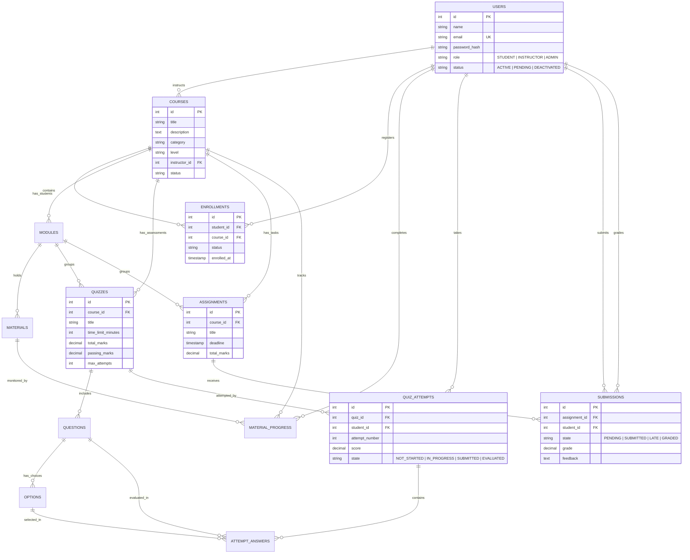
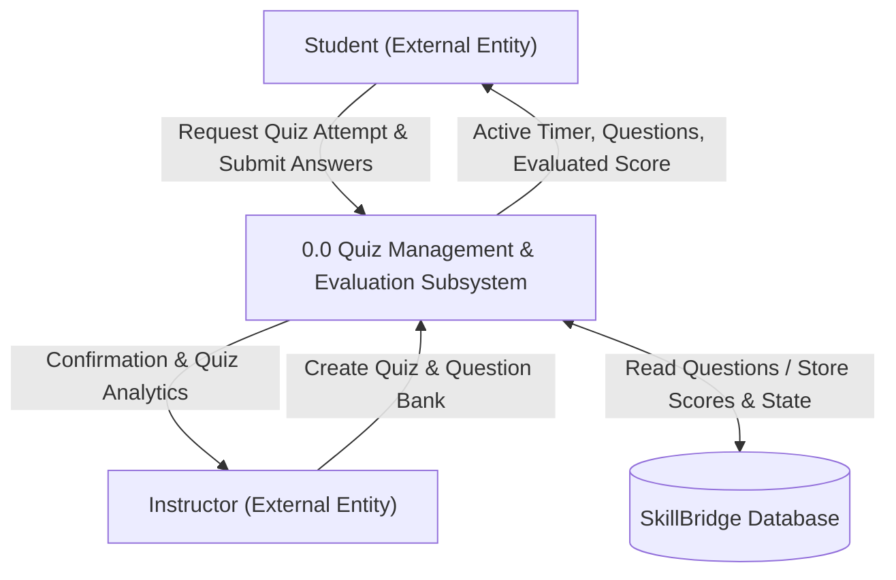
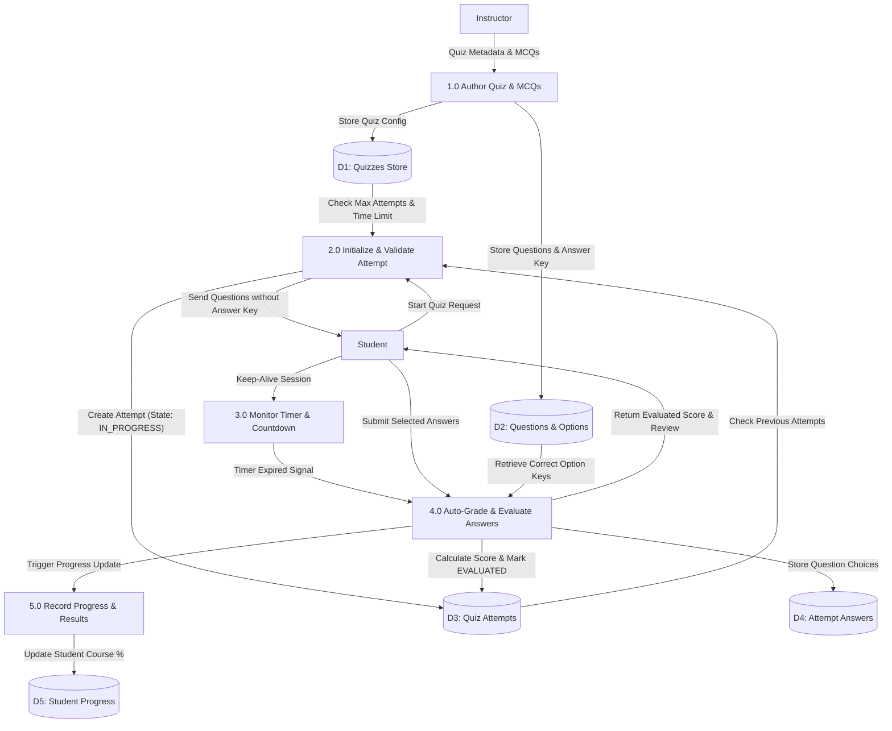
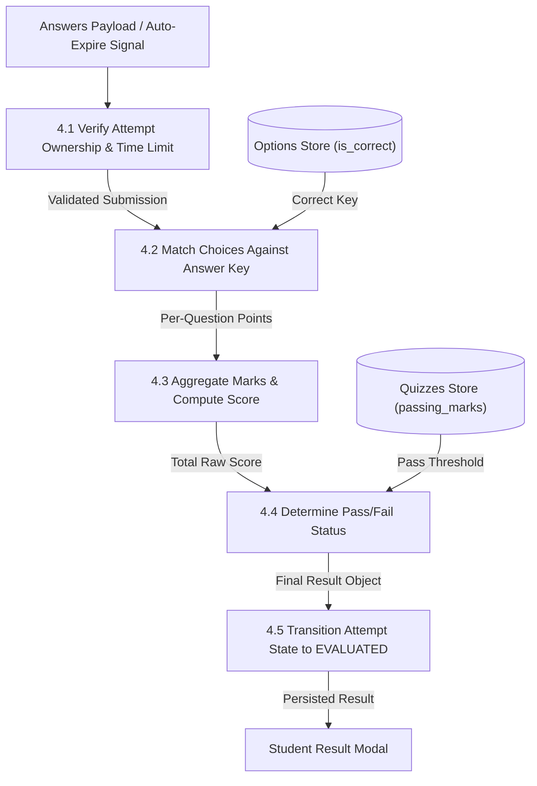
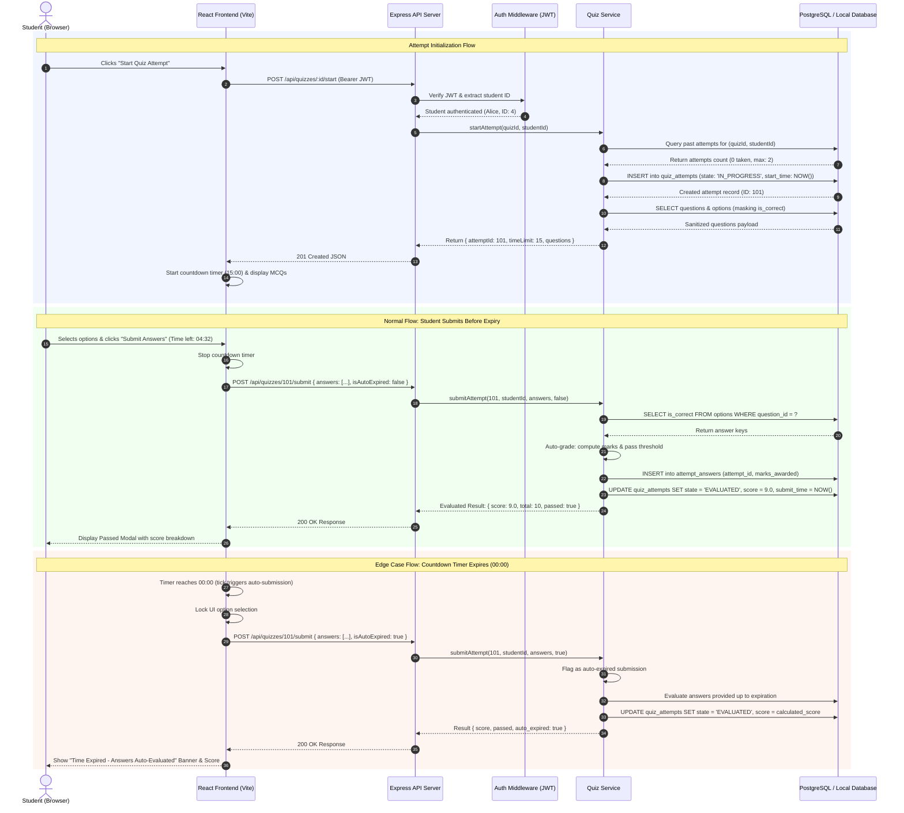
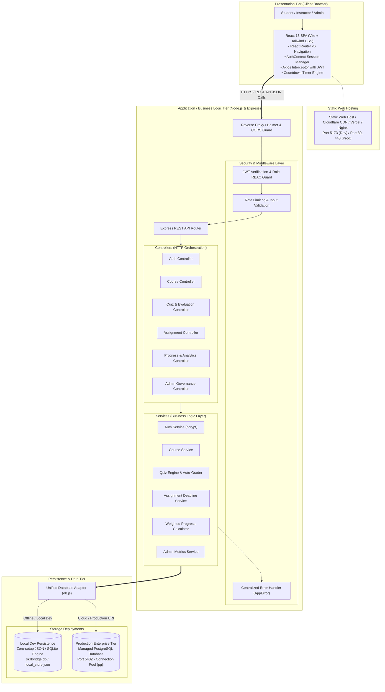

# Software Engineering & Project Management Diagrams
## Project: SkillBridge LMS (Problem #16)

This directory contains the software architecture, process models, and design diagrams required for the SEPM Continuous Comprehensive Assessment (CCA).

---

## 1. Entity-Relationship (ER) Diagram (3NF / BCNF Normalized)
Shows all 13 normalized database tables, primary keys, foreign key constraints, and relational cardinality.

---

## 2. Data Flow Diagrams (DFD) for the Quiz Module

### DFD Level 0 (Context Diagram)
Represents the system boundary and external entity data flows.

### DFD Level 1 (Subsystem Decomposition)
Decomposes the quiz system into 5 major processes and data stores.

### DFD Level 2 (Decomposed Evaluation Process 4.0)
Detailed breakdown of answer verification, scoring, and state transitions.

---

## 3. UML Sequence Diagram: Student Takes and Submits a Quiz
Covers both the **Normal Flow** (submitted within the timer limit) and the **Timer-Expiry Flow** (auto-submission on expiration).

---

## 4. System Architecture & Deployment Diagram
Shows the 3-tier physical/logical deployment topology from Static Frontend Client to Layered REST API and Persistence.

