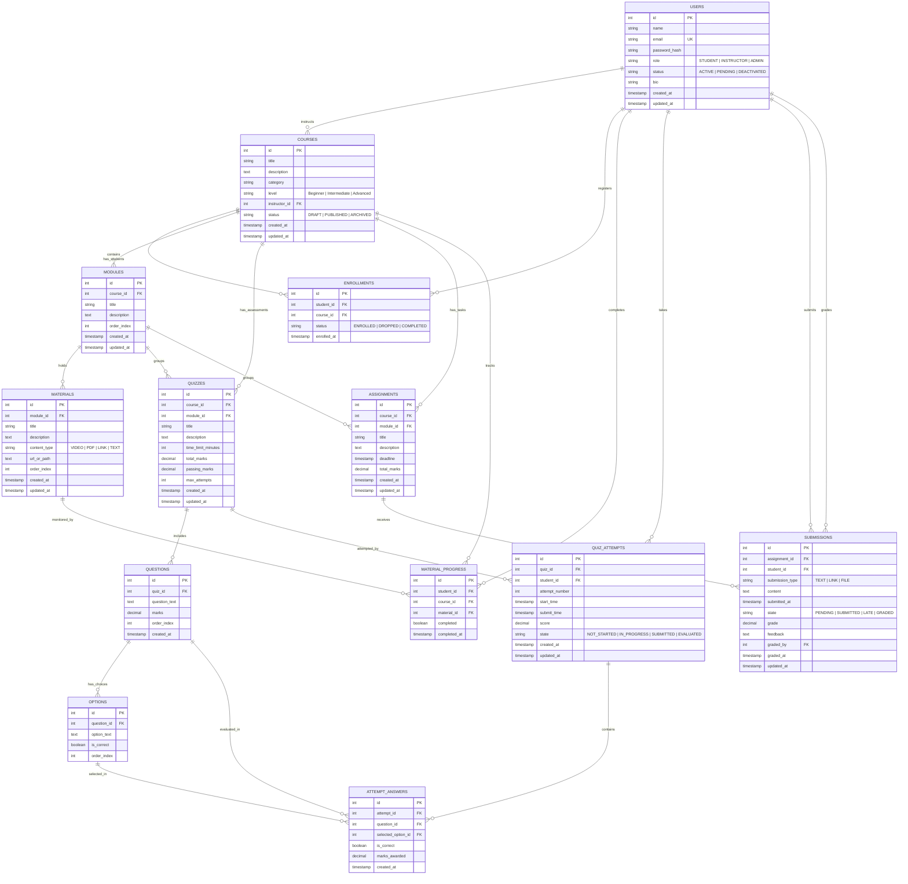

# System Architecture & Database Diagrams

This folder contains the software engineering diagrams for **SkillBridge: Online Skill-Based Learning & Course Management System**.

---

## 1. Entity-Relationship (ER) Diagram

The database schema is fully normalized (conforming to 3NF / BCNF) and consists of 13 interconnected entities.

---

## 2. Upcoming Phase Diagrams (To be generated in Phase 7)
- DFD Level 0, Level 1, and Level 2 for the Quiz Module
- Sequence Diagram: Student Takes and Submits a Quiz (Normal & Time-Expiry flow)
- Architecture and Cloud Deployment Diagram
