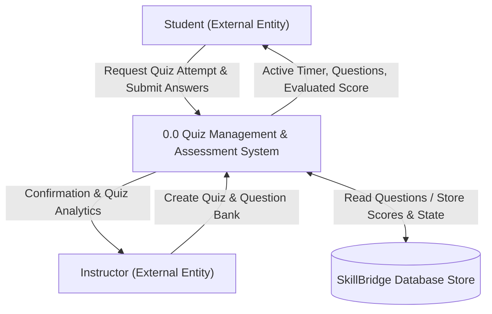
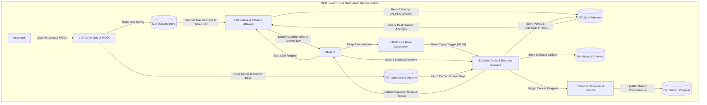
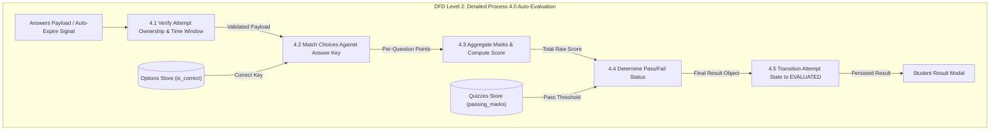
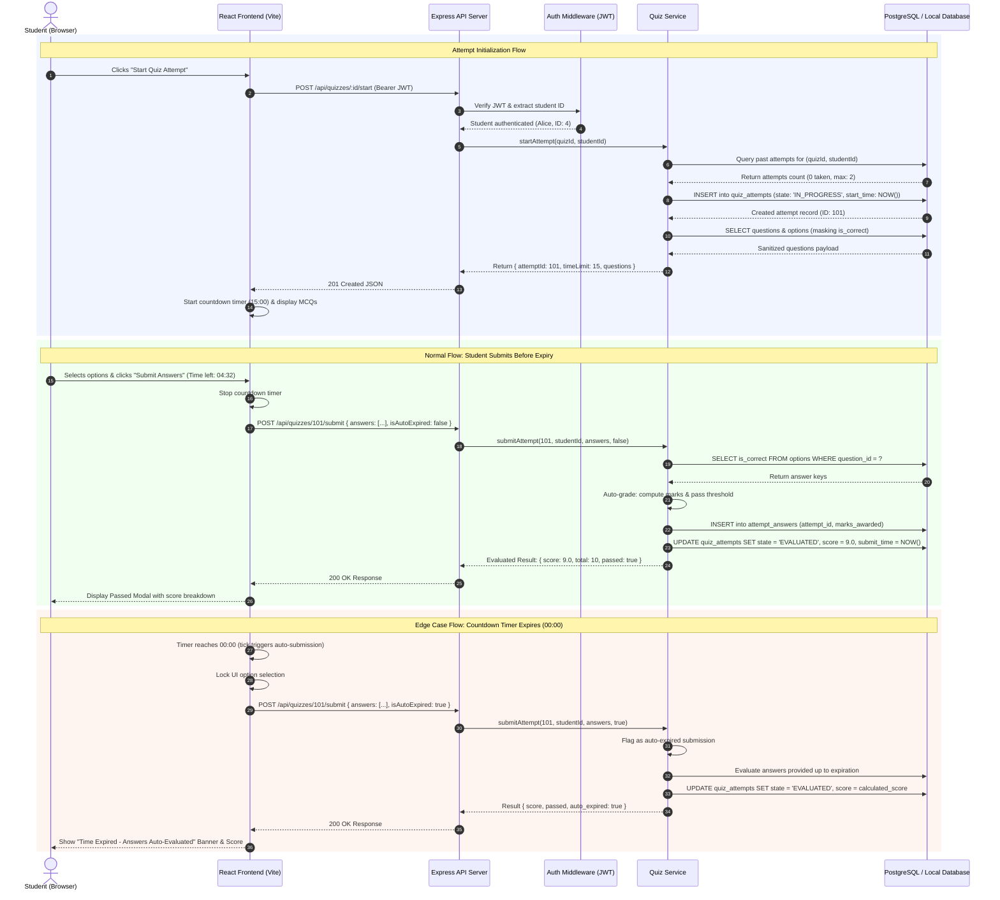
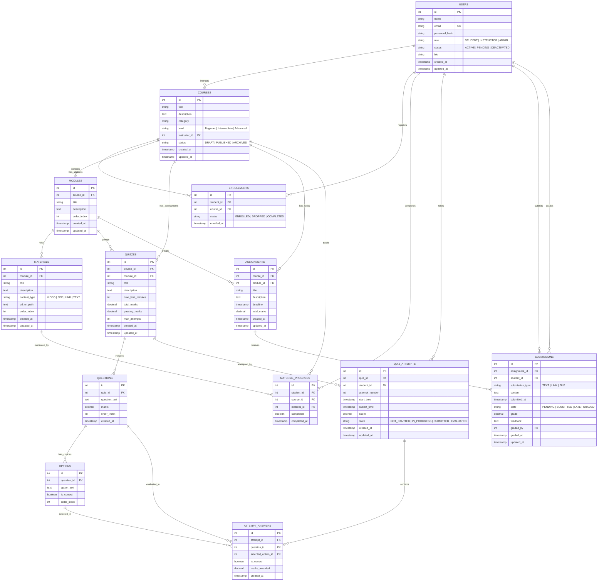
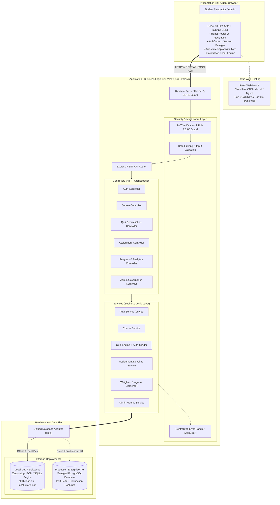

**SKILLBRIDGE**

**Online Skill-Based Learning & Course Management System**

**SOFTWARE ENGINEERING & PROJECT MANAGEMENT**

**CCA – TEAM ACTIVITY (20 MARKS)**

Course Code: [Course Code]

Problem Statement #16: Online Skill-Based Learning & Course Management System

SDG Mapping: SDG 9 – Industry, Innovation and Infrastructure

| **Student** | **Name** | USN | **Branch** | **Assigned Role** |
| --- | --- | --- | --- | --- |
| Student 1 | Satyam Kumar | [Enter roll no.] | AIML | Requirements & Analysis |
| Student 2 | Ayush Kumar | [Enter roll no.] | AIML | Design & Database |
| Student 3 | Vivek Sharma | [Enter roll no.] | AIML | Development & Testing |
| Student 4 | Ranjeet Singh | [Enter roll no.] | AIML | Project Management & Documentation |

Department: Artificial Intelligence and Machine LearbubgAcademic Year: 2026-27

# DOCUMENT CONTROL

| **Parameter** | **Details** |
| --- | --- |
| Project | SkillBridge: Online Skill-Based Learning & Course Management System |
| Version | 1.0 – Final |
| Assessment | CCA – Team Activity (20 Marks) |
| Subject | Software Engineering & Project Management |
| Problem Statement | Problem #16 |
| Repository | https://github.com/VivekArgSharma/sepm-project |
| Development Status | All seven development phases implemented, tested and committed |
| Automated Test Result | 19 passed, 19 total; Jest and Supertest |

# EXECUTIVE SUMMARY

SkillBridge is a fully implemented web-based Online Skill-Based Learning and Course Management System developed for the Continuous Comprehensive Assessment in Software Engineering & Project Management. It addresses the limitations of conventional course-centric Learning Management Systems by combining structured learning resources with measurable assessment activities, deadline enforcement, automated evaluation and progress analytics.

The system has been delivered across all seven development phases. Its frontend is implemented using React 18, Vite and Tailwind CSS. The backend is built with Node.js and Express using a layered architecture comprising routes, controllers, services and middleware. PostgreSQL provides the primary persistence layer through thirteen normalized relational tables designed around 3NF/BCNF principles, supported by a zero-setup local persistent fallback for convenient development and demonstration.

Security is implemented through JWT authentication, bcrypt password hashing with cost factor 10, role-based authorization and parameterized database access. The assessment subsystem provides timed quizzes with a countdown and automatic submission when the timer reaches 00:00. Assignment workflows enforce due dates using server-side timestamps and identify late submissions. Student progress and instructor class-performance analytics provide visibility into learning activity and outcomes.

The project follows Agile Scrum across four two-week sprints. Its backend automated test suite uses Jest and Supertest and contains nineteen passing tests across the API and health-check test suites. The completed work demonstrates requirements engineering, software architecture, database normalization, iterative project management, integration testing and ethical software development.

## REPORT ORGANIZATION

# 1. Introduction

# 2. Requirements Specification (SRS)

# 3. Selected Process Model

# 4. Project Planning & Scheduling

# 5. Software Design & Modelling

# 6. Tools and Collaboration

# 7. Ethical and Professional Considerations

# 8. Conclusion & Future Scope

* References

# 1. INTRODUCTION

## 1.1 Problem Statement

Conventional Learning Management Systems commonly organize digital education around course pages, downloadable resources and basic completion indicators. Such systems may show that a learner opened a course or viewed a document without establishing whether the learner has mastered the specific skills represented by that content. Assessment records, assignment deadlines and progress indicators can also be fragmented across separate workflows.

This creates several practical problems: limited skill-level visibility, manual evaluation effort, inconsistent deadline handling, insufficient feedback loops and difficulty comparing learner progress across a class. A quiz timer that relies only on the browser is also vulnerable to clock manipulation, background-tab suspension and network delay. Similarly, assignment lateness must be determined using a trusted server timestamp rather than a client-supplied time.

SkillBridge addresses these issues through a unified platform that connects course structure, learning materials, timed quizzes, assignments, automated grading and progress analytics. The system provides role-specific functionality for Students, Instructors and System Administrators.

## 1.2 Project Objectives

Develop a centralized web platform for creating, publishing and managing skill-oriented courses.

Implement secure user registration and login using bcrypt password hashing with cost factor 10 and JWT-based authentication.

Enforce role-based access control for Students, Instructors and System Administrators on protected application operations.

Organize learning resources into courses, modules and materials with persistent completion tracking.

Deliver interactive timed quizzes with a visible countdown, server-authoritative expiry and automatic submission at 00:00.

Implement assignment creation, student submissions, server-side deadline comparison and late-submission classification.

Calculate objective quiz grades and aggregate learner progress for student dashboards and instructor class matrices.

Deliver a maintainable three-tier application supported by thirteen normalized database tables and automated Jest/Supertest testing.

## 1.3 Scope and System Boundaries

| **In Scope** | **Out of Scope** |
| --- | --- |
| User registration, login, JWT sessions and RBAC | External university SSO integration |
| Course creation, publication, enrollment and management | Institution-wide ERP/SIS replacement |
| Modules and learning material organization | Commercial content marketplace and payment processing |
| Timed quizzes, attempt validation and countdown | Remote proctoring and biometric surveillance |
| Automatic quiz submission and objective grading | Unsupervised AI grading of subjective essays |
| Assignment creation, submissions and late detection | Advanced plagiarism detection in the initial release |
| Student progress and instructor class matrix | Predictive analytics and automated certification |
| Administrator governance and role permissions | Native mobile applications and large-scale CDN operations |
| PostgreSQL persistence and local persistent fallback | Enterprise multi-region disaster recovery |

The system is a browser-based learning and assessment application. It does not replace institutional academic administration, payment systems or formal examination-proctoring platforms. The application server is authoritative for permissions, attempt state, grading and deadline decisions. PostgreSQL is the primary data store; the local persistent fallback reduces setup friction for local development and demonstrations.

## 1.4 Stakeholder Analysis

| **Stakeholder** | **Profile and Responsibilities** | **Primary Interactions** | **Success Criteria** |
| --- | --- | --- | --- |
| Students | Learners who consume course content and complete assessments. | Browse and enroll in courses; access materials; attempt quizzes; submit assignments; view grades and progress. | Clear navigation, fair timed assessments, accurate results and understandable progress. |
| Instructors | Educators responsible for course structure, materials and assessment activities. | Create courses and modules; publish materials; author quizzes and assignments; review submissions; inspect class matrix. | Efficient content management, reliable evaluation and actionable class-level visibility. |
| System Administrators | Platform operators responsible for user governance and access control. | Manage accounts and permissions; administer platform access; oversee governance operations. | Secure role allocation, controlled privileges and dependable platform operation. |

# 2. REQUIREMENTS SPECIFICATION (SRS)

The SRS defines the externally observable behavior and quality attributes of SkillBridge. Requirements are assigned unique identifiers to support traceability from analysis through design, implementation and testing.

## 2.1 Functional Requirements

| **ID** | **Module** | **Functional Requirement** |
| --- | --- | --- |
| FR-AUTH-01 | Authentication | The system shall allow users to register and log in using validated credentials. |
| FR-AUTH-02 | Authentication | The system shall store passwords only as bcrypt hashes configured with cost factor 10. |
| FR-AUTH-03 | Authentication/RBAC | The system shall issue and validate JWTs and enforce Student, Instructor and Administrator permissions on protected operations. |
| FR-COURSE-01 | Course Management | Authorized instructors shall create, edit, publish and manage courses. |
| FR-COURSE-02 | Course Management | Students shall browse available courses and enroll in courses, with duplicate enrollment prevented. |
| FR-COURSE-03 | Course Management | Instructors shall organize courses into modules and associate learning materials with the relevant module. |
| FR-QUIZ-01 | Quiz Engine | Instructors shall create quizzes containing questions, options, marks and duration settings. |
| FR-QUIZ-02 | Quiz Engine | The system shall validate quiz eligibility and create a persisted attempt with server-recorded start and expiry timestamps. |
| FR-QUIZ-03 | Quiz Engine | The interface shall display a countdown derived from the persisted attempt expiry time. |
| FR-QUIZ-04 | Quiz Engine | When the countdown reaches 00:00, the client shall initiate automatic submission and the server shall independently enforce expiry. |
| FR-QUIZ-05 | Quiz Engine | The system shall prevent unauthorized, duplicate or invalid attempt finalization and evaluate submitted answers. |
| FR-ASG-01 | Assignments | Instructors shall create assignments with instructions and a due date/time. |
| FR-ASG-02 | Assignments | Students shall submit assignment responses or supported file references. |
| FR-ASG-03 | Assignments | The server shall compare the submission receipt timestamp with the assignment deadline and classify late submissions. |
| FR-ASG-04 | Assignments | Authorized instructors shall grade submissions and record feedback. |
| FR-PROG-01 | Progress Tracking | The system shall record material completion and assessment outcomes for each student. |
| FR-PROG-02 | Progress Tracking | The system shall calculate course-level progress using recorded learning activity and a defined completion policy. |
| FR-PROG-03 | Progress Tracking | Instructors shall view a class matrix showing enrolled learners and their progress in courses they own. |
| FR-ADMIN-01 | Administration | Administrators shall manage user accounts and role permissions, including instructor governance. |
| FR-ADMIN-02 | Administration | Administrative and grade-related actions shall be attributable to an authenticated actor. |

### Timed Quiz State Machine

Each quiz attempt follows a controlled state transition model. The server persists the attempt state and timestamps so that the client cannot independently declare an attempt complete.

| **State** | **Meaning** | **Allowed Transition / Trigger** |
| --- | --- | --- |
| NOT_STARTED | The learner has not initiated an attempt. | Start request passes authentication, enrollment, availability and attempt validation → IN_PROGRESS. |
| IN_PROGRESS | An attempt exists and the learner can submit answers before expiry. | Valid manual submission or expiry-triggered automatic submission → SUBMITTED. |
| SUBMITTED | The final answer payload has been accepted and the attempt is closed to further edits. | The grading service evaluates the stored answers → EVALUATED. |
| EVALUATED | The score and answer-level outcomes have been persisted. | Terminal state. Result is available for progress tracking and display. |

| NOT_STARTED   |   | Valid start request   v   IN_PROGRESS   |   | Manual submit OR timer reaches 00:00   v   SUBMITTED   |   | Server-side auto-grading   v   EVALUATED  (terminal state) |
| --- |

The countdown is calculated from the server-provided expires_at timestamp. The browser timer is a presentation mechanism only. On manual submission or timer expiry, the API validates ownership, attempt status and server time. The attempt is finalized once, and the grading operation is protected against duplicate execution.

### Assignment State Model

| **State** | **Meaning** | **Transition** |
| --- | --- | --- |
| PENDING | Assignment is available and no valid submission has been recorded. | Student submits response → SUBMITTED or LATE based on server receipt time. |
| SUBMITTED | Submission was received on or before the deadline. | Instructor evaluates submission → GRADED. |
| LATE | Submission was received after the deadline and has been tagged accordingly. | Instructor evaluates submission → GRADED, retaining late status. |
| GRADED | Instructor has recorded marks and/or feedback. | Terminal grading state; any correction follows authorized update rules. |

| PENDING   | submit_at <= due_at             | submit_at > due_at   v                                 v   SUBMITTED                           LATE   |                                 |   +---------------+-----------------+   |   | Instructor grades   v   GRADED |
| --- |

## 2.2 Non-Functional Requirements

| **Quality Attribute** | **Requirement / Engineering Control** | **Verification** |
| --- | --- | --- |
| Security | bcrypt cost factor 10; signed and expiring JWTs; server-side RBAC; parameterized SQL; input validation; Helmet security headers; restrictive CORS; secrets in environment configuration. | Authentication tests, negative authorization tests, header inspection and code review. |
| Usability and WCAG Accessibility | Responsive layouts, semantic controls, keyboard navigation, visible focus, readable contrast, labels and clear error states; WCAG 2.1 AA-oriented design. | Keyboard walkthrough, contrast checks and accessibility review. |
| Performance | Efficient API queries, appropriate indexes, pagination for larger collections and minimized unnecessary frontend requests. | Representative API timing and load checks. |
| Reliability | Controlled error handling, health checks, persisted attempt state and predictable recovery from service/database errors. | Restart, error-path and integration testing. |
| Data Integrity | Primary/foreign keys, unique constraints, validated relationships, transactions for critical grading/finalization and consistent timestamps. | Constraint tests, duplicate-operation tests and transaction checks. |
| Maintainability | Layered routes/controllers/services/middleware, modular frontend components and consistent naming and API contracts. | Code review and module-boundary inspection. |
| Portability | Environment-based configuration, PostgreSQL support and zero-setup local persistent fallback. | Clean environment setup and local execution checks. |

## 2.3 Assumptions and Dependencies

* Users access the system through a modern browser and a functioning network connection.
* Node.js, npm, PostgreSQL and the required frontend build tooling are available for development and deployment.
* Database credentials and JWT signing secrets are provided through environment variables and are not committed to source control.
* Server time is synchronized and is the authoritative source for quiz expiry and assignment deadlines.

# 3. SELECTED PROCESS MODEL

## 3.1 Agile Scrum with Two-Week Sprints

SkillBridge was developed using Agile Scrum with four two-week sprint iterations. The seven implementation phases were organized into four delivery increments so that requirements, database design, core learning workflows, assessments and analytics could be integrated progressively. Each sprint produced a working increment and included implementation, review and testing activities.

## 3.2 Justification: Agile Scrum versus Traditional Waterfall

| **Criterion** | **Traditional Waterfall** | **Agile Scrum: SkillBridge Application** |
| --- | --- | --- |
| Requirement Change | Changes after requirements sign-off can require formal rework across later phases. | Backlog refinement allows evolving quiz rules, deadline behavior and role permissions to be prioritized between sprints. |
| Feedback Loop | Stakeholder feedback is often concentrated at major phase gates or final acceptance. | Sprint reviews provide regular demonstrations and feedback on working features. |
| Risk Discovery | Integration and technical risks may emerge late, after separate components are completed. | Early integration exposes API, database, timer and authorization risks while there is time to address them. |
| Incremental Delivery | A large integrated release is commonly delivered toward the end of the lifecycle. | Course, material, assessment and progress functionality can be delivered in usable increments. |
| Quality Assurance | Testing may be treated as a downstream phase after implementation. | Testing is integrated into each sprint, supported by automated Jest and Supertest regression checks. |

## 3.3 Sprint Breakdown

| **Sprint** | **Focus** | **Completed Activities** | **Deliverables** |
| --- | --- | --- | --- |
| Sprint 1 (Weeks 1–2) | Requirements, database foundation and authentication | Stakeholder analysis, SRS baseline, three-tier architecture, relational schema, database setup, registration/login, bcrypt hashing, JWT and role middleware. | Requirements baseline, database foundation and secure authentication. |
| Sprint 2 (Weeks 3–4) | Courses and learning materials | Course management, enrollment, module organization, learning material management, course player and material progress recording. | Working course and learning-content workflows. |
| Sprint 3 (Weeks 5–6) | Quizzes and assignments | Quiz authoring and attempts, countdown timer, server-side expiry validation, auto-submit at 00:00, objective grading, assignment deadlines and late detection. | Integrated assessment workflows and automated test coverage. |
| Sprint 4 (Weeks 7–8) | Progress, administration and release verification | Student progress aggregation, instructor class matrix, administrative governance, integration/regression testing, documentation and release preparation. | Completed seven-phase system, final documentation and 19 passing automated tests. |

## 3.4 Scrum Events and Artifacts

| **Scrum Element** | **Application in the Project** |
| --- | --- |
| Product Backlog | Prioritized list of user stories, functional requirements, defects, security tasks and documentation items. |
| Sprint Planning | Selection of backlog items for each two-week sprint, with task owners and acceptance criteria. |
| Daily Stand-ups | Short coordination meetings to report completed work, next steps, blockers and integration dependencies. |
| Sprint Review | Demonstration of completed features, including course workflows, assessment behavior and progress views. |
| Sprint Retrospective | Review of collaboration, estimation, code integration and testing practices to improve the next sprint. |
| Definition of Done | Feature implementation, validation, integration, peer review where applicable, regression checks and documentation update. |

# 4. PROJECT PLANNING & SCHEDULING

## 4.1 Work Breakdown Structure (WBS)

| **WBS Code** | **Task Description** | **Assigned Student** | **Duration (Days)** |
| --- | --- | --- | --- |
| 1.1 | Identify stakeholders, analyze problem statement and define project scope. | Student 1 | 2 |
| 1.2 | Elicit, classify and prioritize functional and non-functional requirements. | Student 1 | 3 |
| 1.3 | Prepare SRS, use cases and acceptance criteria. | Student 1 | 3 |
| 2.1 | Design three-tier architecture and API boundaries. | Student 2 | 2 |
| 2.2 | Design thirteen-table ER model and normalization strategy. | Student 2 | 3 |
| 2.3 | Implement SQL schema, relationships, constraints and indexes. | Student 2 | 5 |
| 3.1 | Implement React frontend structure and API integration. | Student 3 | 5 |
| 3.2 | Implement course, enrollment, module and material workflows. | Student 3 | 5 |
| 3.3 | Implement timed quiz engine, expiry handling and auto-grading. | Student 3 | 5 |
| 3.4 | Implement assignment submissions, deadline validation and late detection. | Student 3 | 3 |
| 3.5 | Develop and execute Jest/Supertest automated tests. | Student 3 | 4 |
| 4.1 | Prepare Scrum plan, sprint schedule, WBS and milestone tracking. | Student 4 | 3 |
| 4.2 | Maintain Kanban workflow, meeting notes and risk register. | Student 4 | Ongoing |
| 4.3 | Prepare DFD, UML, architecture and database documentation. | Student 4 | 5 |
| 4.4 | Compile final report, test evidence and submission materials. | Student 4 | 3 |

## 4.2 Schedule and Milestones

| **Milestone** | **Deliverables** | **Planned Week** | **Completion Evidence** |
| --- | --- | --- | --- |
| M1 – Requirements Baseline | Stakeholder analysis, scope, SRS and acceptance criteria. | Week 1 | Completed SRS and requirements backlog. |
| M2 – Architecture and Database | Three-tier architecture, ER model, thirteen-table schema and authentication foundation. | Week 2 | Implemented schema, database setup and authentication workflows. |
| M3 – Learning Management | Courses, enrollments, modules, materials and course player. | Week 4 | Integrated course and learning-material workflows. |
| M4 – Assessment Engine | Timed quizzes, auto-submit, grading, assignments and late detection. | Week 6 | Working assessment flows and automated API tests. |
| M5 – Progress and Governance | Student progress, instructor class matrix and administrator functions. | Week 7 | Implemented progress and governance workflows. |
| M6 – Final Release | Integration, regression testing, documentation and repository completion. | Week 8 | Final GitHub implementation and 19 passing automated tests. |

## 4.3 Responsibility Allocation Matrix (RACI)

R = Responsible for execution; A = Accountable for the final outcome; C = Consulted during the work; I = Informed of progress.

| **Work Package** | **Student 1****Requirements** | **Student 2****Design/DB** | **Student 3****Dev/Test** | **Student 4****PM/Docs** |
| --- | --- | --- | --- | --- |
| 1. Requirements and SRS | A/R | C | C | C |
| 2. Architecture and ER design | C | A/R | C | I |
| 3. Database schema and constraints | I | A/R | C | I |
| 4. Authentication and RBAC | C | C | A/R | I |
| 5. Courses and learning materials | C | C | A/R | I |
| 6. Quizzes and assignments | C | C | A/R | I |
| 7. Testing and quality assurance | C | C | R | A |
| 8. Project schedule and risk management | C | C | C | A/R |
| 9. Documentation and final release | C | C | R | A/R |

## 4.4 Risk Management Plan

| **Risk** | **Probability** | **Impact** | **Mitigation Strategy** |
| --- | --- | --- | --- |
| Client timer and server expiry become inconsistent. | Medium | High | Persist server-side started_at and expires_at; derive countdown from expiry; enforce expiry during API submission; test delayed requests and background tabs. |
| Duplicate or concurrent quiz submissions. | Medium | High | Use attempt-state validation, idempotent finalization, database transactions and appropriate row-level locking/unique constraints. |
| Unauthorized access to courses, attempts or grades. | Medium | High | Enforce JWT verification, RBAC and ownership checks in middleware/services; include negative authorization tests. |
| Database connection or configuration failure. | Medium | High | Validate environment configuration, expose health checks, document database initialization and maintain the local persistent fallback. |
| Scope expansion and schedule slippage. | High | Medium | Prioritize the product backlog, define sprint goals, control nonessential scope and review progress during stand-ups. |
| Data inconsistency between fallback and PostgreSQL. | Medium | High | Keep persistence access behind a consistent data-access boundary and test equivalent core operations and restart behavior. |
| Integration defects between frontend and backend. | Medium | High | Define API contracts early, integrate continuously, use shared response conventions and run regression tests after changes. |
| Accessibility defects in interactive components. | Medium | Medium | Use semantic controls, visible focus, keyboard testing, clear errors and contrast review throughout development. |

# 5. SOFTWARE DESIGN & MODELLING

## 5.1 DFD Level 0 – Context Diagram

The Level 0 Data Flow Diagram treats SkillBridge as one process, P0 – Online Skill-Based Learning and Course Management System. Three external entities interact with the system: Student, Instructor and System Administrator.

* Student → LMS: registration/login details, enrollment requests, quiz answers, assignment submissions and learning activity.
* LMS → Student: course catalogue, learning materials, attempt status, grades, assignment status and progress information.
* Instructor → LMS: course definitions, modules, materials, quiz questions, assignment instructions and grading inputs.
* LMS → Instructor: enrolled learner lists, submissions, assessment results and class progress matrix.
* Administrator → LMS: account governance, role changes and administrative actions.
* LMS → Administrator: user summaries, action status and platform governance information.

## 5.2 DFD Level 1 – Subsystem Decomposition

The Level 1 DFD decomposes the assessment and learning workflow into five processes. The data stores D1 to D5 represent persistent information used by the processes.

| **Process / Store** | **Description** | **Inputs and Outputs** |
| --- | --- | --- |
| 1.0 Authoring | Manages course structures, modules, materials, quizzes, questions and options. | Receives instructor content and assessment definitions; writes course and assessment data to D1 and D2. |
| 2.0 Attempt Validation | Validates user identity, enrollment, quiz availability and attempt eligibility; creates a quiz attempt. | Receives student start request; reads quiz and enrollment records; creates attempt metadata in D3. |
| 3.0 Timer Monitoring | Tracks attempt expiry using server timestamps and initiates expiry finalization. | Reads attempt start/expiry/status from D3; emits remaining-time and expiry events. |
| 4.0 Auto-Grading | Validates submitted answers and calculates objective marks using the stored answer key. | Receives final answer payload; reads questions/options; writes answer outcomes and score. |
| 5.0 Progress Logging | Records completed learning activities and assessment outcomes for progress views. | Receives grades and completion events; updates D5 and supports student/instructor analytics. |
| D1 – Course Store | Stores courses, modules and learning materials. | Read/write by Authoring and course/progress workflows. |
| D2 – Assessment Store | Stores quizzes, questions and options. | Written by Authoring; read by Attempt Validation and Auto-Grading. |
| D3 – Attempt Store | Stores quiz attempts, start/expiry timestamps and attempt status. | Written by Attempt Validation; read/updated by Timer Monitoring and Auto-Grading. |
| D4 – Submission Store | Stores assignment submissions and grading metadata. | Written by assignment workflows; read by instructors and progress reporting. |
| D5 – Progress Store | Stores material progress and learner performance summaries. | Updated by Progress Logging; read by Students and Instructors. |

## 5.3 DFD Level 2 – Process 4.0 Auto-Evaluation

Process 4.0 performs deterministic evaluation of objective quiz answers. It uses the authoritative question and option records stored by the instructor. Correctness is never accepted from the browser as a trusted value.

| **Subprocess** | **Operation** | **Result** |
| --- | --- | --- |
| 4.1 – Load Attempt Context | Retrieve attempt, quiz, question and scoring metadata using the attempt identifier. | Validated assessment context. |
| 4.2 – Validate Submission | Verify ownership, attempt status, expiry and that submitted question/option identifiers belong to the quiz. | Accepted or rejected submission. |
| 4.3 – Evaluate Answers | Compare selected options against stored correct options and apply the configured scoring rule. | Per-question correctness and earned marks. |
| 4.4 – Aggregate Score | Sum awarded points and calculate percentage against maximum available marks. | Final score and percentage. |
| 4.5 – Persist and Finalize | Persist answer outcomes and aggregate result in a transaction; mark attempt EVALUATED. | Durable result available for progress tracking. |

### Detailed Auto-Grading Algorithm

Begin a database transaction and retrieve the quiz attempt using a lock or equivalent concurrency control.

Verify that the authenticated user owns the attempt and that the attempt is in the IN_PROGRESS state.

Compare the server's current timestamp with expires_at. If the attempt has expired, process the request under the expiry-submission policy.

Load the authoritative questions, options, correct-answer metadata and marks associated with the quiz.

Validate every submitted question identifier and selected option identifier against the quiz definition. Reject identifiers belonging to another quiz.

For each question, compare the submitted selection with the stored correct selection. Apply the configured scoring rule; for single-answer objective questions, award the question marks only for an exact correct match.

Accumulate earned marks and maximum marks. Calculate percentage as earned marks divided by maximum marks multiplied by 100, where maximum marks is greater than zero.

Persist answer-level outcomes and the aggregate score. Update submission/finalization timestamps and the attempt state atomically.

Commit the transaction and return the finalized result. A repeated request must not award marks twice or modify an already finalized attempt.

### Procedural Pseudocode

| FUNCTION evaluateAttempt(attemptId, authenticatedUser, answerPayload):   BEGIN TRANSACTION   attempt = LOAD_ATTEMPT_FOR_UPDATE(attemptId)   IF attempt.ownerId != authenticatedUser.id:   ROLLBACK   RETURN FORBIDDEN   IF attempt.status != 'IN_PROGRESS':   ROLLBACK   RETURN ALREADY_FINALIZED_OR_INVALID_STATE   currentTime = SERVER_TIMESTAMP()   IF currentTime >= attempt.expiresAt:   submissionReason = 'AUTO_EXPIRED'   ELSE:   submissionReason = 'MANUAL'   questions = LOAD_QUESTIONS_AND_ANSWER_KEYS(attempt.quizId)   earnedMarks = 0   maximumMarks = 0   FOR EACH question IN questions:   selected = VALIDATE_SELECTION(   answerPayload, question.id, attempt.quizId   )   correct = LOAD_AUTHORITATIVE_CORRECT_OPTION(question.id)   IF selected EXACTLY_MATCHES correct:   awarded = question.marks   ELSE:   awarded = 0   SAVE_ANSWER_OUTCOME(   attempt.id, question.id, selected, awarded   )   earnedMarks = earnedMarks + awarded   maximumMarks = maximumMarks + question.marks   IF maximumMarks > 0:   percentage = (earnedMarks / maximumMarks) * 100   ELSE:   percentage = 0   UPDATE_ATTEMPT(   status = 'EVALUATED',   score = earnedMarks,   submittedAt = currentTime,   submissionReason = submissionReason   )   COMMIT TRANSACTION   RETURN {   earnedMarks,   maximumMarks,   percentage,   status: 'EVALUATED'   } |
| --- |

## 5.4 Data Dictionary

| **Data Flow** | **Source** | **Destination** | **Data Elements / Description** |
| --- | --- | --- | --- |
| 1. Registration Request | Student / Instructor | Authentication API | Name or profile fields, email, password and validated registration data. |
| 2. Authentication Token | Authentication Service | Protected API Middleware | JWT subject, role, issue time, expiry and token claims. |
| 3. Course Definition | Instructor | Authoring Process / D1 | Course identifier, title, description, owner, publication state and skill metadata. |
| 4. Learning Material | Instructor | Material Store / Student UI | Material identifier, module identifier, title, type, resource reference and display order. |
| 5. Enrollment Request | Student | Enrollment Service | Student identifier, course identifier, request timestamp and enrollment status. |
| 6. Quiz Start Request | Student | Attempt Validation | User identifier, quiz identifier, authentication context and start request. |
| 7. Attempt Metadata | Attempt Validation | Timer Monitoring / D3 | Attempt identifier, started_at, expires_at, duration and status. |
| 8. Timer Expiry Event | Timer Monitoring | Auto-Grading | Attempt identifier, expiry timestamp and expiry-triggered submission reason. |
| 9. Answer Submission | Student UI | Auto-Grading | Attempt identifier, question identifiers, selected option identifiers and submission payload. |
| 10. Grade Result | Auto-Grading | Progress Logging / Student UI | Earned marks, maximum marks, percentage, answer outcomes and final state. |
| 11. Assignment Submission | Student | Assignment Service / D4 | Assignment identifier, student identifier, response/file reference and server receipt timestamp. |
| 12. Progress Snapshot | Progress Logging | Student / Instructor | Material completion, quiz results, assignment status and course-level progress indicators. |

## 5.5 UML Sequence Diagram Walkthrough

### 5.5.1 Normal Submission Flow

In the normal flow, the student submits answers before the expiry timestamp. The API validates the attempt, the grading service evaluates the answers and the database stores the result.

| Student UI       Express API       Attempt Service      Grading Service       Database   |                |                    |                    |                  |   |-- Start Quiz ->|                    |                    |                  |   |                |-- Validate ------->|                    |                  |   |                |                    |-- Create attempt -------------------->|   |                |                    |<-- attemptId, expiresAt ---------------|   |<-- Attempt ----|                    |                    |                  |   |                |                    |                    |                  |   |  Answer quiz   |                    |                    |                  |   |                |                    |                    |                  |   |-- Submit ----->|-- Validate state -->|                    |                  |   |                |                    |-- Evaluate answers ->|                  |   |                |                    |                    |-- Read answer key>|   |                |                    |                    |<-- Questions -----|   |                |                    |                    |-- Save result --->|   |                |                    |                    |<-- Commit --------|   |<-- Grade ------|<-------------------|<-------------------|                  |   |                |                    |                    |                  | |
| --- |

### 5.5.2 Timer-Expiry Auto-Submit Flow

When the countdown reaches 00:00, the frontend automatically posts the current answer payload. The server independently verifies that the attempt has expired, finalizes the attempt and invokes the grading process. This prevents the client from controlling the official expiry decision.

| Student UI       Countdown Timer       Express API       Grading Service       Database   |                    |                   |                    |                  |   |<-- Remaining time -|                   |                    |                  |   |                    |                   |                    |                  |   |   Timer = 00:00    |                   |                    |                  |   |                    |-- Auto POST ----->|                    |                  |   |                    |  attempt + answers|                    |                  |   |                    |                   |-- Check server time                  |   |                    |                   |-- Verify expires_at                  |   |                    |                   |-- Finalize request ->|                |   |                    |                   |                    |-- Load key ---->|   |                    |                   |                    |<-- Questions ---|   |                    |                   |                    |-- Save grade -->|   |                    |                   |                    |<-- Commit ------|   |<-- Submitted / Result -----------------|<-------------------|                  |   |                    |                   |                    |                  | |
| --- |

The server remains authoritative if the browser tab is suspended, the client clock is changed or the network request is delayed. Attempt-state validation and transactional persistence prevent repeated grading or post-expiry answer modification.

## 5.6 Database Design and Normalization

SkillBridge uses a relational database containing thirteen normalized tables. The schema separates user identity, course structure, learning resources, assessment definitions, individual attempts, answer records and assignment submissions. Primary keys uniquely identify entities, while foreign keys and uniqueness constraints preserve referential integrity.

| **Table** | **Purpose** | **Foreign Key Relationships** |
| --- | --- | --- |
| users | Stores user identity, profile information, password hash and role/status. | Referenced by courses, enrollments, progress, attempts and submissions. |
| courses | Stores course metadata and ownership. | owner_id → users. |
| enrollments | Associates students with courses and stores enrollment state. | student_id → users; course_id → courses; unique student/course pair. |
| modules | Stores ordered learning units within a course. | course_id → courses. |
| materials | Stores learning resources associated with modules. | module_id → modules. |
| material_progress | Records completion state for each student and material. | user_id → users; material_id → materials; unique user/material pair. |
| quizzes | Stores quiz metadata, duration and availability. | References owning course/module according to the implemented schema. |
| questions | Stores quiz question text, type and marks. | quiz_id → quizzes. |
| options | Stores selectable answer options and correctness metadata. | question_id → questions. |
| quiz_attempts | Stores student quiz attempts, timestamps, status and aggregate score. | user_id → users; quiz_id → quizzes. |
| attempt_answers | Stores answer-level selections and awarded marks. | attempt_id → quiz_attempts; question_id → questions. |
| assignments | Stores assignment instructions, due dates and grading configuration. | References owning course/module and author as defined by the schema. |
| submissions | Stores student responses, receipt time, late status, grade and feedback. | assignment_id → assignments; student_id → users. |

### First Normal Form (1NF)

* Every table has a primary key and each attribute stores an atomic value.
* Repeating groups are separated into related rows rather than embedded in a single record.
* Quiz options are stored as individual rows in the options table rather than as repeated option columns.
* Student answers are stored as separate attempt_answers records rather than as arrays or comma-separated values in a quiz_attempts row.
* Course enrollment is represented through the enrollments relationship table.

### Second Normal Form (2NF)

* Every non-key attribute must depend on the whole candidate key, not merely part of a composite key.
* Surrogate primary keys provide stable row identifiers for the principal entities.
* Relationship uniqueness constraints, such as the student/course pair in enrollments and user/material pair in material_progress, prevent duplicate relationship records.
* Course descriptions belong in courses, student profile attributes belong in users, and relationship-specific attributes belong in the relevant junction table.
* This separation eliminates partial dependencies and reduces update anomalies.

### Third Normal Form (3NF) and BCNF

* Non-key attributes depend on the key, the whole key and nothing but the key.
* Course attributes are stored in courses rather than repeated in every enrollment record.
* Question content is stored in questions, while option text and correctness metadata are stored in options.
* Attempt-specific selections and awarded marks are stored in attempt_answers rather than in the question or option definitions.
* Assignment due dates belong to assignments, while actual receipt timestamps and late classification belong to submissions.
* User identity and role attributes are stored in users rather than duplicated across course, quiz and submission records.
* Unique constraints and candidate keys enforce the intended determinants. Relations are designed to satisfy 3NF and BCNF where each determinant is a candidate key.
Normalization improves consistency, reduces insertion/update/deletion anomalies and provides a clear basis for relational integrity. Foreign keys, uniqueness constraints and indexes support dependable joins and efficient access to commonly queried relationships.

## 5.7 Three-Tier Architecture and Deployment

| **Tier** | **Technology** | **Responsibilities** |
| --- | --- | --- |
| Presentation Tier | React 18, Vite, Tailwind CSS | Renders responsive pages, navigation, course player, quiz countdown, assignment interfaces, progress dashboards and role-specific views. Communicates with the backend through API requests. |
| Application Tier | Node.js, Express; routes, controllers, services and middleware | Implements API endpoints, authentication, RBAC, validation, course logic, attempt lifecycle, timer expiry enforcement, auto-grading, assignment deadlines and progress aggregation. |
| Data Tier | PostgreSQL with thirteen normalized tables; zero-setup local persistent fallback | Persists users, courses, enrollments, modules, materials, progress, quizzes, questions, options, attempts, answers, assignments and submissions. |

| +-----------------------------------+   | PRESENTATION TIER                 |   | React 18 + Vite + Tailwind CSS    |   | Browser UI / Course Player        |   +----------------+------------------+   |   | HTTPS / JSON API   v   +-----------------------------------+   | APPLICATION TIER                  |   | Node.js + Express                 |   | Routes -> Controllers -> Services |   | Middleware: JWT / RBAC / Errors   |   +----------------+------------------+   |   | SQL / Data Access   v   +-----------------------------------+   | DATA TIER                         |   | PostgreSQL                        |   | 13 normalized relational tables  |   | Local persistent fallback        |   +-----------------------------------+ |
| --- |

### Deployment Topology

Local development uses a developer workstation running the React/Vite development server and the Node.js/Express API. PostgreSQL can be used as the primary database, while the local persistent fallback provides a zero-setup execution path for supported development and demonstration scenarios. Environment variables configure database selection, connection details and JWT secrets.

In cloud production, the frontend is deployed as a static web application and communicates with the hosted Express API over HTTPS. The API connects to a managed or separately hosted PostgreSQL instance through restricted network access. Secrets remain server-side, database access is not exposed to the browser, and production deployment uses secure headers, controlled CORS, logs, health checks and database backup practices.

# 6. TOOLS AND COLLABORATION

## 6.1 Version Control and Git Workflow

Git and GitHub are used for source control, collaboration, change history and release management. The project repository is:

https://github.com/VivekArgSharma/sepm-project

| **Branch / Practice** | **Purpose** |
| --- | --- |
| main | Stable integration branch containing the completed project. |
| feature/<module>-<description> | Isolated development of authentication, courses, quizzes, assignments, progress or administration. |
| bugfix/<issue> | Focused correction of a reproducible defect. |
| docs/<artifact> | Changes to SRS, diagrams, planning documents and project report. |
| Commit discipline | Use concise imperative commit messages, keep changes logically scoped and avoid committing secrets or generated build output. |
| Integration review | Review API/schema impact, run relevant tests and merge completed work into the stable branch. |

## 6.2 Project Management: Kanban Workflow

| **Board State** | **Meaning** | **Exit Condition** |
| --- | --- | --- |
| Backlog | All identified features, user stories, defects and improvements. | Priority and acceptance criteria are understood. |
| To Do | Work selected for the active sprint and ready to begin. | Owner and dependencies are identified. |
| In Progress | Implementation or documentation is actively underway. | Work is complete and local checks have been run. |
| Review | Work is ready for peer review, testing or demonstration. | Review feedback is addressed and acceptance criteria are met. |
| Done | Work is accepted and integrated. | Required tests pass and relevant documentation is updated. |

The workflow provides visibility into task ownership, work in progress, blockers and completion. It complements Scrum sprint planning and review activities.

## 6.3 Testing Strategy and Automated Results

The project uses Jest as the JavaScript test runner and Supertest for HTTP-level testing of Express endpoints. The automated backend suite contains two test files and nineteen passing test cases.

| **Testing Layer** | **Coverage** | **Purpose** |
| --- | --- | --- |
| Unit Testing | Service functions, validation helpers, deadline comparison and score calculation. | Verify isolated business rules and edge cases. |
| API Integration Testing | Authentication, health endpoints, protected routes and API request/response behavior. | Verify that Express routes, middleware and service logic work together. |
| Negative / Security Testing | Missing or invalid JWTs, unauthorized roles, malformed payloads and invalid identifiers. | Verify rejection behavior and prevent unauthorized access. |
| Data Integrity Testing | Required fields, foreign keys, unique relationships and state transitions. | Verify persistent records remain consistent. |
| UI / Acceptance Checks | Responsive layouts, course navigation, countdown display, auto-submit behavior, keyboard use and error states. | Verify user-facing workflows and interaction quality. |

### Automated Test Execution Transcript

The backend test suite is executed using Jest. Supertest drives API-level requests against the Express application.

| $ npm test   > backend@1.0.0 test   > jest --runInBand   PASS  tests/api.test.js   PASS  tests/health.test.js   Test Suites: 2 passed, 2 total   Tests:       19 passed, 19 total   Snapshots:   0 total   Time:        1.923 s   Ran all test suites. |
| --- |

The completed automated run reports 2 passing test suites and 19 passing tests, with zero failed tests. The API integration suite verifies backend request handling and the health suite verifies service availability behavior. The automated test result forms part of the project's final verification evidence.

## 6.4 Repository File Structure

| **Directory** | **Contents and Responsibility** |
| --- | --- |
| /backend | Express server, routes, controllers, services, middleware, database configuration, schema and backend tests. |
| /frontend | React 18 application, Vite configuration, Tailwind styling, components, pages and API integration. |
| /diagrams | DFD, UML sequence, ER model and architecture diagrams. |
| /requirements | SRS, stakeholder analysis, use cases and functional/non-functional requirements. |
| /planning | Agile sprint plan, WBS, milestones, RACI matrix and risk register. |
| /report | Final academic project report and supporting documentation. |
| /presentation | CCA presentation slides, demonstration notes and viva material. |

# 7. ETHICAL AND PROFESSIONAL CONSIDERATIONS

SkillBridge handles learner identity, course participation, assessment responses and grades. The development process therefore considers privacy, security, accessibility, intellectual property, accuracy and accountability as core engineering responsibilities.

| **Ethical Area** | **Commitment** | **Technical / Process Controls** | **Verification** |
| --- | --- | --- | --- |
| 1. Privacy and Consent | Collect only information necessary for accounts, course participation and assessment. Avoid unnecessary sensitive personal information. | Minimal profile fields, purpose-limited data collection, restricted grade access and careful handling of logs. | Review stored fields, access rules and data exposure in API responses. |
| 2. Security | Protect credentials, sessions, course content and assessment records from unauthorized access or modification. | bcrypt password hashing with cost factor 10; expiring JWTs; server-side RBAC; CORS restrictions; Helmet headers; parameterized SQL; environment-managed secrets. | Authentication and authorization tests, security-header inspection and query review. |
| 3. Fairness and Accessibility | Make learning and assessment workflows usable by people with different interaction and accessibility needs. | WCAG 2.1 AA-oriented contrast, keyboard navigation, visible focus, semantic labels, clear error states and non-color-only status cues. | Keyboard walkthrough, contrast review and accessibility inspection. |
| 4. Intellectual Property and Licensing | Respect copyright and license obligations for source code, dependencies, icons, fonts and learning materials. | Original student-authored project code; attribution of third-party libraries; use of open-source dependencies according to their actual licenses, including MIT where applicable. | Review dependency licenses and provide attribution in project documentation. |
| 5. Accuracy and Safety | Ensure that quiz scores and assignment lateness are calculated consistently and cannot be controlled by untrusted client values. | Server-authoritative timestamps, deterministic objective scoring, stored answer keys, transactional finalization and late-submission tagging. | Boundary tests around expiry/deadline, repeat-submission tests and score calculation tests. |
| 6. Transparency and Accountability | Make grade outcomes, permissions and administrative actions attributable and understandable. | Documented grading rules, authenticated role checks, attributable grade changes and controlled permission updates. | Review role enforcement, grade records and administrative action history. |

## 7.1 Professional Practice Principles

* Confidentiality: never expose passwords, JWT signing secrets, database credentials or private learner records in source control, logs or public demonstrations.
* Integrity: use peer review, automated tests and controlled release practices to reduce defects and prevent unauthorized changes.
* Accountability: ensure that project contributions, grading actions and administrative operations can be attributed to responsible actors.
* Academic honesty: identify original work accurately and acknowledge third-party libraries, references and reused learning resources.
* Accessibility: treat inclusive interaction and readable presentation as quality requirements rather than optional visual enhancements.
* Transparency: communicate assessment rules, deadline behavior, progress calculations and system limitations clearly to users.
* Responsible maintenance: keep dependencies updated, handle errors safely and preserve reproducible setup and testing instructions.

# 8. CONCLUSION & FUTURE SCOPE

## 8.1 Summary of Completed Achievements

SkillBridge has been completed across all seven development phases and delivers an integrated online learning and course management platform. The project translates the assigned problem statement into a working system that supports course management, structured learning materials, timed quizzes, automatic submission, assignment workflows, deadline enforcement and progress analytics.

The React 18 frontend provides the presentation layer, while the layered Node.js/Express backend separates routes, controllers, services and middleware. PostgreSQL stores the system's thirteen normalized entities and relationships, with a zero-setup local persistent fallback supporting convenient local execution. JWT authentication, bcrypt password hashing and role-based authorization protect application functionality.

The assessment engine supports a persisted quiz attempt lifecycle, a visible countdown and automatic submission at 00:00. The server independently validates expiry and evaluates objective answers. Assignment workflows compare server receipt timestamps against due dates and classify late submissions. Progress tracking consolidates learning activity and assessment results for students and instructors.

The team applied Agile Scrum through four two-week sprints, maintained work using Git/GitHub and Kanban practices, and completed automated backend verification with Jest and Supertest. The final test suite reports nineteen passing tests across two test suites.

## 8.2 Known Limitations

* Advanced plagiarism detection is not included in the initial system and may require integration with a specialist service.
* Large-scale video delivery and adaptive bitrate streaming require additional media infrastructure and content delivery capabilities.
* Automated grading is appropriate for objective question formats; subjective assignments still require instructor judgment.
* Full WCAG conformance requires formal accessibility evaluation across browsers, assistive technologies and user scenarios.
* Production-scale availability, multi-region recovery and enterprise monitoring require infrastructure beyond a standard academic deployment.
* Advanced predictive analytics and personalized skill recommendations are not part of the current implementation.

## 8.3 Future Enhancements

| **Enhancement** | **Description** | **Expected Benefit** |
| --- | --- | --- |
| AI-Generated Questions | Generate draft quiz questions from instructor-approved course materials, with human review before publication. | Reduces assessment authoring effort while retaining instructor control. |
| Plagiarism Detection | Integrate text similarity checking for assignment submissions and provide explainable similarity reports. | Supports academic integrity and instructor review. |
| Adaptive Video Streaming | Add adaptive bitrate video, captions, transcripts and playback progress synchronization. | Improves multimedia learning and accessibility. |
| Skill Graphs | Map courses, modules and assessments to skills and learning outcomes. | Provides granular competency tracking and personalized learning pathways. |
| Learning Recommendations | Recommend practice material based on quiz outcomes and incomplete learning objectives. | Helps students focus on areas requiring improvement. |
| Notifications | Add in-app and email reminders for deadlines, feedback and course announcements. | Improves learner engagement and reduces missed deadlines. |
| Advanced Analytics | Provide cohort-level trends, question difficulty analysis and instructor reports. | Supports evidence-based course improvement. |

# REFERENCES

[1] Meta Platforms, Inc., “React Documentation,” React.dev. [Online]. Available: https://react.dev/. Accessed: Nov. 19, 2026.

[2] OpenJS Foundation, “Express – Production Best Practices: Security,” Express Documentation. [Online]. Available: https://expressjs.com/en/advanced/best-practice-security.html. Accessed: Nov. 19, 2026.

[3] PostgreSQL Global Development Group, “PostgreSQL Documentation.” [Online]. Available: https://www.postgresql.org/docs/. Accessed: Nov. 19, 2026.

[4] OWASP Foundation, “Password Storage Cheat Sheet,” OWASP Cheat Sheet Series. [Online]. Available: https://cheatsheetseries.owasp.org/cheatsheets/Password_Storage_Cheat_Sheet.html. Accessed: Nov. 19, 2026.

[5] OWASP Foundation, “SQL Injection Prevention Cheat Sheet,” OWASP Cheat Sheet Series. [Online]. Available: https://cheatsheetseries.owasp.org/cheatsheets/SQL_Injection_Prevention_Cheat_Sheet.html. Accessed: Nov. 19, 2026.

[6] World Wide Web Consortium (W3C), “Web Content Accessibility Guidelines (WCAG) 2.1,” W3C Recommendation, Jun. 5, 2018. [Online]. Available: https://www.w3.org/TR/WCAG21/.

[7] K. Schwaber and J. Sutherland, “The Scrum Guide,” Nov. 2020. [Online]. Available: https://scrumguides.org/scrum-guide.html.

[8] Jest Contributors, “Jest Documentation.” [Online]. Available: https://jestjs.io/docs/getting-started. Accessed: Nov. 19, 2026.

[9] Lad, “Supertest: HTTP Assertions,” GitHub repository. [Online]. Available: https://github.com/ladjs/supertest. Accessed: Nov. 19, 2026.

[10] V. Sharma and SkillBridge Project Team, “SkillBridge: Online Skill-Based Learning & Course Management System,” GitHub repository. [Online]. Available: https://github.com/VivekArgSharma/sepm-project. Accessed: Nov. 19, 2026.

